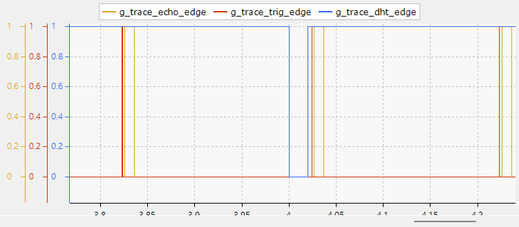

# F411_LAB

STM32F411 + 초음파 센서(HC-SR04 계열) + 온습도 센서(DHT) 실습 프로젝트입니다.

## PuTTY 출력 · 오실로스코프 측정

먼저 **UART 출력(PuTTY)**과 **오실로스코프**로 초음파 센서의 동작을 확인했습니다. 이후 아래의 [SWV 데이터 트레이스](#swv-데이터-트레이스-관찰)로 같은 동작을 CPU를 멈추지 않고 더 자세히 관찰했습니다.

### 1. PuTTY (UART) 출력

USART2를 `printf`로 리다이렉트해서 COM6 포트에 출력하고 PuTTY로 확인했습니다. 시작 메시지에 `HC-SR04: TRIG=PA1, ECHO=PA0, 5 Hz sample, 1 Hz median`이 찍히고, 이후 1초마다 아래 두 줄이 출력됩니다 (`Core/Src/main.c`).

| 줄 | 형식 | 의미 |
|---|---|---|
| `D` | `D,타임스탬프(ms),거리(mm),valid,errors` | 5회 중앙값으로 필터한 거리, 유효 여부, 누적 에러 수 |
| `C` | `C,ticks` | 마지막 Echo 펄스 폭 원시값 (1 tick = 1 µs) |

관찰한 내용입니다.

- `D`의 타임스탬프가 63000, 64000, … 으로 **1000 ms 간격**이라 1 Hz 게시 주기가 맞습니다.
- `C`를 거리로 환산하면(`ticks × 0.1715`) `D`와 비슷합니다. 예를 들어 `C,10099`는 약 1732 mm이고 `D,66000,1726`과 거의 같습니다. 중앙값과 최신 원시값의 시점 차이로 몇 mm 어긋납니다.
- 물체가 움직이는 동안 `D`가 37 → 46 → 196 → 1726 mm로 빠르게 변하다가 1742 ~ 1762 mm에서 안정됩니다. 같은 구간에서 `C`는 약 10,100 ~ 10,300 tick으로, 뒤에서 SWV로 관찰한 Echo 폭(약 10 ms)과 같은 수준입니다.
- `C,3365`처럼 한 번 튀는 원시값이 있어도 바로 다음 `D,71000,1762`는 거의 그대로입니다. 중앙값 필터가 이상값을 걸러내는 것으로 보입니다.
- 72000 ms에서 `errors`가 2에서 3으로 한 번 늘고 거리가 617 mm로 바뀝니다. 이후 `C`는 약 3,500 tick (약 600 mm)입니다.
- `valid`는 전 구간에서 1입니다.

### 2. 오실로스코프 (Tektronix TDS2012B)

| 항목 | 값 |
|---|---|
| 장비 | Tektronix TDS2012B (100 MHz, 1 GS/s) |
| 채널 | CH1, 2.00 V/div |
| 시간축 | 2.50 ms/div |
| 트리거 | Trig'd (트리거 잡힘) |
| 커서 (시간) | Δt = 2.100 ms, ΔV = 3.36 V |

- 펄스 진폭이 약 3.36 V로 3.3 V 로직 레벨에 해당합니다.
- 커서로 잰 펄스 폭은 **2.100 ms**입니다. Trig 펄스는 10 µs라서 이 시간축에서 보이지 않으므로, 측정한 신호는 Echo 핀으로 보입니다.
- 이 폭을 거리로 환산하면 `2100 × 0.1715 ≈ 360 mm`입니다.
- 커서에 표시된 476.2 Hz는 `1/Δt` 값이며 이 신호의 주파수는 아닙니다.

오실로스코프로 잰 Echo 폭(시간)과 PuTTY의 `C` 값(tick)을 같은 조건에서 맞춰보면 타이머가 1 tick = 1 µs로 동작하는지 검증할 수 있습니다.

## SWV 데이터 트레이스 관찰

PuTTY와 오실로스코프로 확인한 뒤, `Core/Src/ultrasonic.c` 등의 동작을 **SWV(Serial Wire Viewer) 데이터 트레이스**로 관찰한 기록입니다.
CPU를 멈추지 않고 전역 변수의 쓰기(Write) 이벤트를 타임스탬프와 함께 캡처했습니다.

| 관찰 | 내용 |
|---|---|
| ① | Echo 펄스 폭 · 엣지 카운트 (변수 4개) |
| ② | Trig / Echo 의 Rising · Falling 엣지 |
| ③ | 초음파 + 온습도(DHT) 동시 관찰 |

### 1. 관찰 ① Echo 펄스 폭 · 엣지 카운트

관찰 구간은 약 83.35 s ~ 84.3 s (약 1 s)입니다.

| 관찰 항목 | 그래프에서 확인한 내용 | 코드와의 대응 |
|---|---|---|
| `g_trace_echo_state` (파란선) | 83.4, 83.6, 83.8, 84.0, 84.2 s 부근에서 주기적으로 튀어 오름 | `US_SAMPLE_PERIOD_MS = 200` → 200 ms마다 트리거 |
| `g_trace_echo_edge` (주황선) | 트리거 직후 올라갔다가 약 10 ms 뒤 0으로 내려옴 | Echo 핀 Rising 때 1, Falling 때 0 |
| `g_trace_echo_ticks` (빨간선) | 10,000 tick 근처에서 거의 일정 | Echo 펄스 폭(1 tick = 1 µs) → 약 10 ms |
| `g_trace_edge_count` (초록선) | 측정할 때마다 계단식으로 증가 | Rising/Falling 각각 +1 → 측정 1회당 +2 |

정리하면 다음과 같습니다.

- 트리거 간격이 200 ms로 일정하게 찍혀서, 폴링 방식 `Ultrasonic_Task()`의 샘플 주기가 설계대로 동작함을 확인했습니다.
- Echo 폭이 약 10,000 µs로 일정하면 거리는 대략 1.7 m 수준입니다 (`10000 × 3430 / 20000 ≈ 1715 mm`). 눈금을 읽은 추정값이라 정확한 값은 `Ultrasonic_Result`로 확인해야 합니다.
- `g_trace_edge_count`는 Echo 엣지가 빠짐없이 들어오면 측정마다 정확히 2씩 늘어납니다. 그래프에서 계단 간격이 일정해서 엣지 누락은 보이지 않습니다.
- 파란선(state)은 평소 바닥(0 상태)에 있다가 트리거 시점에 2로 올라가는 것으로 보입니다. 축 범위가 1~2라서 0은 바닥에 붙어 보입니다.

### 2. 관찰 ② Trig / Echo Rising · Falling 엣지

`g_trace_trig_edge`(빨간선)와 `g_trace_echo_edge`(주황선)만 놓고 본 그래프입니다. 관찰 구간은 약 52.95 s ~ 53.9 s입니다.

- Trig는 53.0, 53.2, 53.4, 53.6, 53.8 s에 찍혀 **200 ms 간격**으로 일정합니다.
- Trig는 폭이 10 µs(`US_TRIG_PULSE_US`)라서 이 시간축에서는 펄스가 아니라 세로 선 하나로 보입니다.
- Echo는 Trig 직후 Rising으로 올라가 **약 10 ms 동안 High**를 유지한 뒤 Falling으로 내려옵니다. ①번 그래프의 Echo 폭(약 10,000 tick)과 일치합니다.
- 매 주기마다 Trig → Echo Rising → Echo Falling 순서가 같고 빠진 주기가 없습니다.

### 3. 관찰 ③ 초음파 + 온습도(DHT) 동시 관찰

`g_trace_echo_edge`(주황), `g_trace_trig_edge`(빨강), `g_trace_dht_edge`(파랑) 세 신호를 한 화면에 겹친 그래프입니다. 관찰 구간은 약 3.77 s ~ 4.23 s입니다.

- **초음파**: Trig가 약 3.825 s, 4.025 s, 4.225 s 부근에 찍혀 여기서도 200 ms 주기가 유지됩니다. 각 Trig 뒤에 Echo 펄스(약 10 ms)가 이어집니다.
- **DHT**: `g_trace_dht_edge`는 평소 High이고, 약 4.00 s ~ 4.02 s에 **약 20 ms 동안 Low**로 내려갔다가 다시 High로 돌아옵니다. DHT11/DHT22의 시작 신호(호스트가 라인을 18 ms 이상 Low로 당김)로 보입니다.
- DHT의 응답과 40비트 데이터는 µs 단위 펄스라서 이 시간축에서는 구분되지 않습니다. 보려면 시간축을 확대해야 합니다.
- 이 구간에서는 DHT 시작 신호가 끝난(4.02 s) 직후에 초음파 Trig(약 4.025 s)가 이어집니다. 두 센서가 같은 루프에서 번갈아 동작할 때 서로 시간이 겹치는지 확인할 때 보는 지점입니다.

> `g_trace_trig_edge`, `g_trace_dht_edge`는 현재 저장소 코드에는 반영되어 있지 않습니다. 위 해석은 그래프에서 읽은 내용이며, 코드에 추가하면 갱신 위치까지 보강할 예정입니다.

### 4. 관찰한 변수

| Comparator | 변수 | 타입 | 값의 의미 | 갱신 위치 |
|---|---|---|---|---|
| 0 | `g_trace_echo_edge` | `uint8_t` | 1 = Echo High 구간, 0 = Low / 타임아웃 | `Ultrasonic_OnEchoEdge()`, 타임아웃 처리 |
| 1 | `g_trace_echo_ticks` | `uint16_t` | 마지막 Echo 펄스 폭 (tick) | Falling 엣지 |
| 2 | `g_trace_echo_state` | `uint8_t` | 0 = 대기, 1 = Echo High, 2 = 트리거 후 Echo 대기 | `Ultrasonic_Task()`, `Ultrasonic_OnEchoEdge()` |
| 3 | `g_trace_edge_count` | `uint32_t` | Echo 엣지 누적 횟수 | Rising / Falling 엣지 |

`state` 변화 순서는 `0 → 2 (트리거 송출) → 1 (Rising 엣지) → 0 (Falling 엣지)`입니다.
Echo가 35 ms(`US_ECHO_TIMEOUT_MS`) 안에 돌아오지 않으면 `edge`와 `state`가 0으로 초기화되고 에러 카운트가 올라갑니다.

②, ③번에서 추가로 본 변수입니다 (그래프 기준).

| 변수 | 의미 (그래프에서 추정) |
|---|---|
| `g_trace_trig_edge` | 초음파 Trig 핀 레벨. 1 = High, 0 = Low |
| `g_trace_dht_edge` | DHT 데이터 라인 레벨. 평소 1, 시작 신호 구간에서 0 |

### 5. SWV 설정

아래 설정은 ①번 그래프를 캡처할 때의 설정입니다. ②, ③번은 관찰한 변수가 달라서 Comparator에 등록한 변수가 다릅니다.

| 항목 | 값 |
|---|---|
| 코어 클럭 | 84 MHz |
| SWO 클럭 | 2000 kHz (클럭 프리스케일러 42) |
| 타임스탬프 | 활성화, 프리스케일러 1 |
| PC 샘플링 | 비활성화 |
| 트레이스 이벤트 (CPI / SLEEP / FOLD / EXC / LSU / EXETRC) | 모두 비활성화 |
| ITM 포트 | 모두 비활성화 |
| Comparator 0~3 | 모두 활성화, 액세스 `Write`, 생성 `Data Value + PC` |

DWT 비교기는 4개뿐이라 동시에 관찰할 수 있는 변수도 최대 4개입니다. ①번은 4개를 모두 썼고, ②번은 2개, ③번은 3개를 썼습니다.

### 6. 재현 방법

1. 프로젝트를 Debug 모드로 빌드하고 디버그 세션을 시작합니다.
2. Debug 설정의 **Serial Wire Viewer** 옵션에서 관찰할 변수를 Comparator 0~3에 등록합니다.
3. SWV 데이터 트레이스 타임라인 그래프 뷰를 열고 변수를 추가합니다.
4. Resume 후 SWV 트레이스를 시작합니다 (Start Trace).
5. 센서를 향해 물체를 움직이면 `g_trace_echo_ticks`가 거리에 비례해 변하는 것을 볼 수 있습니다.

### 7. 참고

- 관련 코드: `Core/Src/ultrasonic.c`, `Core/Inc/ultrasonic.h`
- 타이머는 TIM1을 1 tick = 1 µs로 사용합니다 (`US_TIMER_TICKS_PER_US = 1`).
- 거리 계산은 `width_us × 음속(×10) / 20000` (mm), 5회 중앙값 필터를 거쳐 1초마다 게시됩니다.
