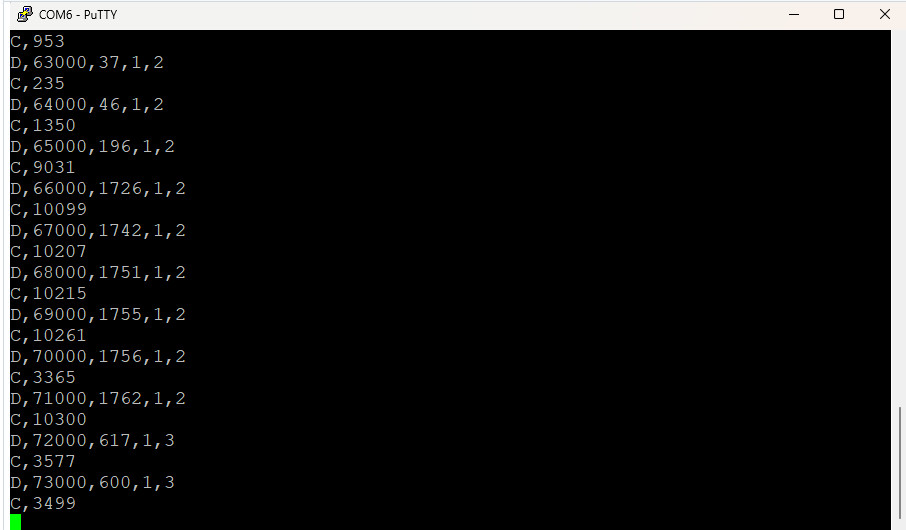
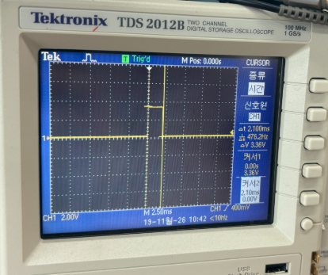
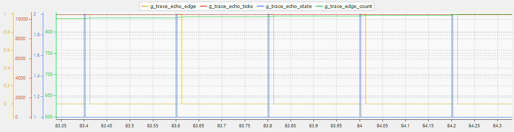
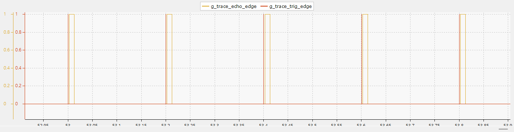
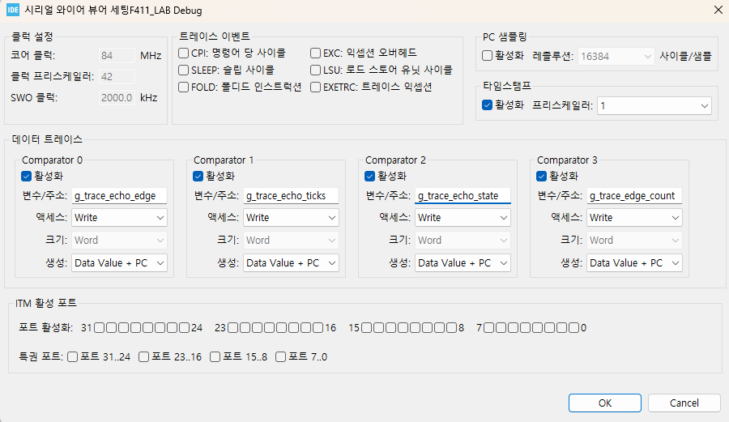

# F411_LAB

STM32F411 + 초음파 센서(HC-SR04) + 온습도 센서(DHT) 실습 프로젝트입니다.

## 1. PuTTY · 오실로스코프

### PuTTY (UART)

- `D,시간(ms),거리(mm),valid,errors`: 5회 중앙값 거리, 1초마다 출력
- `C,ticks`: 마지막 Echo 폭 (1 tick = 1 µs)
- `C × 0.1715 ≈ D`로 두 값이 서로 맞음 (예: `C,10099` ≈ 1732 mm, `D` 1726 mm)
- `C`가 튀어도(`3365`) `D`는 유지되어 중앙값 필터가 동작함

### 오실로스코프

- Echo 펄스 폭 **2.1 ms**, 진폭 3.36 V → 약 360 mm

## 2. SWV 데이터 트레이스

### ① Echo 폭 · 엣지 카운트

- 트리거 200 ms 주기, Echo High 약 10 ms (약 1.7 m)
- 엣지 카운트는 측정마다 +2로 누락 없음

### ② Trig / Echo 엣지

- Trig → Echo Rising → 약 10 ms 후 Falling 순서가 매 주기 반복

### ③ 초음파 + 온습도(DHT)

- DHT 라인이 4.00~4.02 s에 약 20 ms Low (DHT 시작 신호로 보임)
- 직후에 초음파 Trig가 이어짐

> `g_trace_trig_edge`, `g_trace_dht_edge`는 아직 저장소 코드에 없어서 그래프 기준으로만 정리했습니다.

### SWV 설정 (①번 기준)

- 코어 84 MHz, SWO 2000 kHz, 타임스탬프 활성화
- Comparator 0~3: `g_trace_echo_edge`, `g_trace_echo_ticks`, `g_trace_echo_state`, `g_trace_edge_count` (Write, Data Value + PC)
